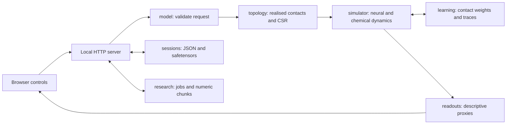

# Human Emotion

A local workbench for exploring a reduced spiking model of emotion circuits. It
combines 21 model regions, delayed synapses, projected neuromodulators and optional
contact-level learning, with replayable sessions and local research protocols.

The interface shows simulated activity and hand-designed descriptive readouts.
These are exploratory proxies, not measurements of a person's feelings. Empirical
validation is **false**. No real participant cohort was downloaded or analysed for
this upgrade.

This source-only snapshot excludes local notes, real participant data, weights,
session state, generated research outputs and historic execution reports. The
empty memory template is illustrative. Source protocols retain units, provenance,
participant and stimulus separation, and training-fold fitting rules. Synthetic
execution tests do not establish biological or clinical validity.

## Quick start on Windows

The implementation environment uses Windows, Python **3.14.4**, Node.js
**26.2.0** and uv **0.13.6**. Use this repository's own `.venv`; the launcher does
not search a parent environment. Dependencies are pinned in `uv.lock` and
`package-lock.json`.

From the repository root in PowerShell, select one PyTorch extra. The CUDA build
is PyTorch 2.11.0 with CUDA 12.8, suitable for the RTX 5090 used here.

```powershell
$env:PYTHONUTF8 = '1'
uv sync --locked --python 3.14.4 --extra cuda --extra research --dev
npm ci --ignore-scripts
.venv/Scripts/python.exe server.py
```

For a CPU installation, replace the `uv sync` command with:

```powershell
uv sync --locked --python 3.14.4 --extra cpu --extra research --dev
```

The `cpu` and `cuda` extras are mutually exclusive. To force CPU execution with
the CUDA build installed, set `$env:HUMAN_EMOTION_DEVICE = 'cpu'` before starting.
Research dependencies are optional for interactive simulation; retain them for
the complete development checks and empirical preparation commands.

After setup, double-click **Start Human Emotion.cmd** or run `server.py` as above.
The server opens the browser on `127.0.0.1`, initially trying ports 8766 to 8775.
It saves the selected port in `.local/server.json` to preserve the browser origin
and reports a conflict if another service later occupies that port. It stops
after its idle timeout, allowing active simulations and queued experiments to
finish.

The source includes POSIX paths and locking support. On Linux, the Python entry
point is `.venv/bin/python server.py` after a CPU setup. Linux has not been tested
for this upgrade. The `.cmd` launcher is Windows only.

## Use the workbench

**Simulation** runs an independent episode by default. Set numeric sensory, body
and control inputs, choose a size and seed, then inspect regional firing, receptor
occupancy, sampled spikes and EEG-like traces. A seed controls a run's random
input; comparisons also require the same realised topology, configuration,
starting weights and compute backend. Bitwise CPU/CUDA equivalence is not promised.

**Sessions** retain learned weights between episodes. `learn` commits a revision,
`evaluate` disables learning and leaves weights unchanged, and `replay` applies
learning without committing. Each episode resets fast neural and chemical state.
Exported checkpoints contain JSON and safetensors, including the realised graph.
See [learning and persistence](docs/LEARNING.md) for equations and retry semantics.

**Experiments** submit local versioned jobs with progress, cancellation and resume.
Continuous research chunks preserve full simulator state. The EEG, fMRI, ratings
and session-order workflows, data provenance rules and explicit acquisition
commands are documented in [the research guide](docs/RESEARCH.md).

**Memory** keeps browser-local annotations and backups. Browser notes can contain
personal information. Model session records exclude names, photos and event notes.
The app does not infer numerical input from free text, faces or structural MRI.

## How it works



Configuration lives in `brain_model/network.json`. Projection, SST/PV and VIP
populations are separate from the glutamate/GABA transmission channels. Contacts
retain their individual weights and plasticity flags; canonical sparse matrices
sum contacts sharing a transmission slot. Numerical integration stays together in
`simulator.py`. [Architecture and units](docs/ARCHITECTURE.md) describe these seams.

## Checks and benchmark

Run the combined check command from the repository root:

```powershell
.venv/Scripts/python.exe tools/check.py
```

It checks Python formatting, Ruff, Pyright, Biome, JavaScript types, Node tests and
pytest. It forces CPU episodes and returns a nonzero status if a check fails.
The small CUDA transmission check also runs when a CUDA device is available.
Add `--coverage` for coverage, or `--browser` for Playwright tests using an
**installed Google Chrome**. `npm ci --ignore-scripts` does not install a browser.
The browser checks include contract fixtures and a small real Python service.

For individual lint commands, use `.venv/Scripts/python.exe -m ruff check .` and
`npm run lint`. The optional whole-model scenarios are separate from the default
checks. Their historical implementation report recorded two failing threat
scenarios; this source-only snapshot does not claim those scenarios now pass:

```powershell
.venv/Scripts/python.exe tests/check_scenarios.py --neurons 16384 --seeds 1
.venv/Scripts/python.exe benchmark.py 16384 --steps 100
```

The benchmark reports actual graph build time, milliseconds per integration step,
estimated full-episode time and memory where supported. Choose a small size first.
CUDA allocation may step down to a configured smaller size; the response records
requested and actual counts. The largest configured size is not a fit guarantee.

## Scientific limits

Region sizes, wiring, gains and clearance constants are modelling priors. Each
contact represents a reduced connection, not a measured human synapse. The SST/PV
population is pooled, and broad region names do not imply atlas-level resolution.
Chemical plots show dimensionless receptor occupancy from 0 to 1. EEG-like traces
are arbitrary-unit current proxies with no scalp forward model. Readout scores
are normalised model summaries, not calibrated probabilities.

Learning rules are explicit experiments. Dopamine eligibility uses occupancy
relative to a pre-stimulus baseline, without a reward target or value function.
Reproducible mechanics, attractive plots and completed jobs do not establish
biological validity. The [roadmap](ROADMAP.md) prioritises remaining calibration
and cohort evaluation. Dataset and stimulus licences are recorded separately in
the [research guide](docs/RESEARCH.md); the project licence applies only to the original code.

## Licence

Original project code is source-available under the [PolyForm Noncommercial
License 1.0.0](LICENSE). Commercial use requires separate permission. Third-party
code, assets and dependencies retain their own terms; see [LICENSING.md](LICENSING.md).
Earlier grants for previously released copies remain valid.
